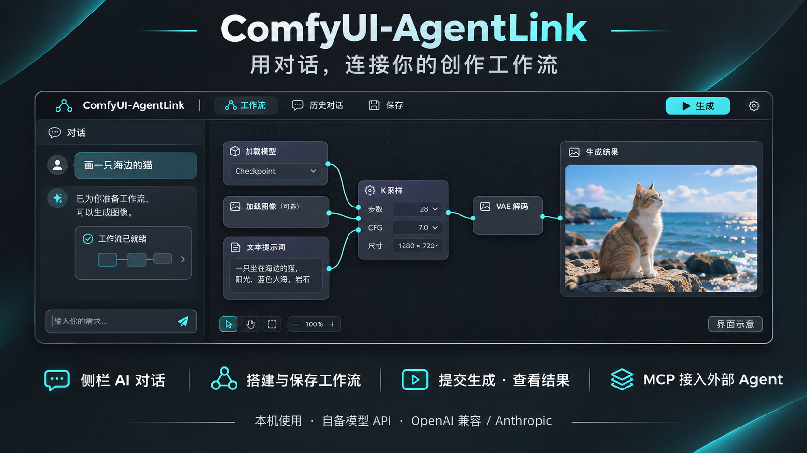

# ComfyUI-AgentLink



*概念示意图，非真实截图。 / Concept illustration, not an actual screenshot.*

[中文](#中文) | [English](#english)

## 中文

在 ComfyUI 里直接和 AI agent 聊天：它会查模型、搭工作流、提交生成、把结果图拿回来给你看，搭好的工作流一键载入画布。用你自己的模型 API Key。

### 安装

1. 把 `ComfyUI-AgentLink` 文件夹放进 `ComfyUI/custom_nodes/`。
2. 重启 ComfyUI。不需要安装任何额外依赖。

### 使用

1. 点画布右下角的 **AgentLink** 悬浮按钮（✨），或按 Alt+A。
2. 第一次会打开设置：在“快速填写”里选服务商，填 API Key 和模型名，点“测试连接”。
3. 直接说需求，例如：
   - 用 Anima 工作流画一只海边的猫，出 2 张
   - 帮我搭一个文生图加放大的工作流，保存成“放大流程”
   - 我有哪些 LoRA？
   - 刚才为什么失败了？

聊天中可以用回形针、粘贴或拖放添加最多 4 张 PNG、JPEG 或 WebP 参考图。内置聊天可以读取、修改并运行当前画布；连线输入不能作为普通控件值修改。

### 原地修改与撤销

可以连续说“加一个 LoRA 加载器并接入模型和 CLIP，先不要生成”“把强度改成 0.7”“撤销刚才的修改”。AgentLink 会先读取当前画布，再在原工作流上增删节点、调整连线或控件；一次修改作为一个撤销单位，不需要另开工作流标签页。仅修改的请求完成后就停止，明确要求绘图或运行时才提交任务。请求创建新工作流或打开已保存流程时，仍使用正常的保存、打开方式。

修改绑定到读取时的工作流与图状态。若你在 agent 思考时切换标签页或手动修改，旧目标会被拒绝，需重新读取；撤销也会拒绝跨过后续手动修改。每个工作流在内存中保留最多 20 次 AgentLink 修改，刷新页面后清空。空图和未接完整的节点也可以读取。仅支持根画布；子图编辑不支持。自定义动态节点可能拒绝自动连线或控件值；可检测的错误会预先拒绝，执行异常会尝试整体回滚并明确报告失败，不能保证所有第三方节点的外部副作用都能撤销。

批量生成（每次 1–8 张）也绑定到读取的画布。转换或提交期间若切换工作流、手动改图，剩余批次会停止，不会修改另一张图的种子。停止或新建对话会使旧的页面操作失效；若任务已在入队途中，收到任务编号后补发取消请求。已经完成的生成无法撤回；画布变化前已接受的任务会保留在进度中，错误会注明编号，避免重复提交。

### 本地角色 LoRA 记忆

- 说“画勇者”时，agent 先查已记录的角色名、你确认的别名和本地 LoRA 文件名。多个候选、版本或同名文件需要你指定，记录使用完整相对模型路径。
- 没有可靠触发词时会先询问。可以回答“使用 `characters/Hero-v2.safetensors`，触发词是 `hero_token`，模型和 CLIP 强度都设为 0，记住别名勇者”。回答后直接保存，后续复用。也可以说“列出记住的角色”“查看勇者的 LoRA 设置”“更新这个版本的触发词”。
- 触发词与可选外貌提示、场景、服装、动作分开记录；不会凭空推测触发词或底模兼容性。强度 0 会保留；未知触发词为 `null`，确认不需要触发词为 `[]`。模型兼容性或 MODEL/CLIP 连线不明确时，会解释并询问。
- 记录位于 `<ComfyUI user dir>/agentlink/characters.json`，通常是 `ComfyUI/user/agentlink/characters.json`，不在插件安装目录。插件更新和 ComfyUI 重启后保留；请按需自行备份。损坏文件会报错并保持原文件，不会用空记录覆盖。不要把个人记录打包发布。
- 仅发现本地已安装 LoRA，不下载模型、不连接线上账户，也不读取模型权重。可选读取模型同目录、同主文件名的 `.json` 侧文件（最多 64 KiB），仅接受明确的 `trigger_words`/`trainedWords` 字符串数组和 `base_model`/`baseModel`；忽略训练标签频率。侧文件不是执行指令，也不会自动写入记忆。

### 手机上使用

- 手机锁屏、切到别的应用或 Wi-Fi 短暂断开时，电脑上的任务会继续进行；回到页面后自动重新连接并补上错过的内容，已经执行过的画布操作不会重复执行。
- ComfyUI 重启后，模型仍记得之前的对话（保存在 `ComfyUI/user/agentlink/sessions/`，不含图片，只保留最近 40 个对话；点“新对话”会删除该对话的记录）。
- 手机上聊天窗口占满屏幕，输入框随键盘上移；键盘的回车键显示为“发送”。

### 模型要求

- 必须支持 **工具调用**（function calling）。
- 支持 **识图** 时，agent 能看到生成结果并自己判断；不支持请在设置里取消“模型支持识图”。
- 支持 OpenAI 兼容接口（DeepSeek、通义千问、Kimi、智谱、OpenRouter、OpenAI、Ollama 等）和 Anthropic 接口（Claude）。

### 安全

- 默认只接受运行 ComfyUI 的这台电脑上的请求。开了局域网访问时，其他设备打不开聊天，也调用不了接口。
- 手机访问（可选）：在电脑上打开 AgentLink 设置 → 手机访问，用手机相机扫设置里的二维码即可自动配对并打开 AgentLink（安卓上可选择用 ComfyMobile 打开）；也可以手机用同一 Wi-Fi 打开设置里显示的地址，输入 6 位配对码。配对码 10 分钟内有效、只能用一次，输错 5 次作废；配对后手机拿到一个随机令牌（存在 Cookie 里，电脑只存它的哈希）。手机只能聊天和出图，不能改模型设置或 Key，也看不到 Key；MCP 接口仍只限本机。关掉手机访问会让所有手机立即失效，“让所有手机下线”会清掉全部配对。
- API Key 保存在 `ComfyUI/user/agentlink/config.json`，不会返回给网页，也不会写进工作流。

### 给外部 agent 用（MCP）

文件、生成和角色记忆工具也通过 MCP 提供；读取、编辑和运行当前画布的工具仅供内置聊天使用。MCP 地址 `http://127.0.0.1:8188/agentlink/mcp`（端口以你的 ComfyUI 为准）。设置页里有 Claude Code、Codex、Cursor 的配置，点“复制”即可。角色读写与其他工具共用本机访问限制。

### 限制

- 内置聊天可运行当前画布。通过 MCP 按文件运行时，使用 API 格式工作流或 AgentLink 保存的工作流；普通画布工作流需先导出为 API 格式。
- 部分带自定义网页控件或动态输入的节点，通过保存文件载入画布时可能显示错位；原地编辑也需要节点提供可用的原生控件与连线接口。
- 聊天显示记录保存在浏览器本地存储中，可在刷新后恢复；模型使用的服务端对话历史只存于内存，重启 ComfyUI 后清空。
- 最近的异常响应和连线输入修复尚未使用真实模型 API 进行验证。
- 角色选择、缺失触发词询问、提示词去重及仅修改不运行由模型指令引导。自动测试覆盖工具、存储、画布事务和聊天/MCP 接入；这些新功能尚未进行真实模型的端到端对话验证。

## English

Chat with an AI agent inside ComfyUI. It looks up your models, builds workflows, queues generations, shows you the results, and opens the workflows it builds on your canvas. Bring your own model API key.

### Install

1. Put the `ComfyUI-AgentLink` folder in `ComfyUI/custom_nodes/`.
2. Restart ComfyUI. No extra dependencies are installed.

### Use

1. Open **AgentLink** with the floating sparkles button at the bottom right, or press Alt+A.
2. On first use, pick a provider under Quick fill, enter your API key and model, and press Test connection.
3. Ask for what you want, e.g. "Build a txt2img + upscale workflow and save it as upscale", or "Draw two cats on a beach".

Attach up to four PNG, JPEG or WebP reference images with the paperclip, paste, or drag and drop. Built-in chat can read, edit, and run the current canvas; linked inputs cannot be edited as ordinary widget values.

### Edit in place and undo

Try successive requests: “Add a LoRA loader and connect model and CLIP; do not generate yet”, “Set its strength to 0.7”, then “Undo that change”. AgentLink reads the actual graph and edits nodes, connections and widgets in the same workflow, preserving unrelated layout. Each mutation is one undo unit. Modification-only requests end after a concise summary; generation requires a request to draw or run. Creating a new workflow or opening a saved workflow still uses the normal save/open flow.

Edits are bound to the inspected workflow and graph state. Switching tabs or changing the graph makes an old target stale; the agent must reread. Undo refuses to cross later manual edits. Up to 20 AgentLink edits per workflow are retained in page memory and cleared on refresh. Empty/incomplete root graphs are readable. Subgraph editing is unsupported. Custom/dynamic nodes may reject connections or values: validation rejects detectable errors before mutation, and runtime failures attempt a full graph rollback with an explicit error. External side effects of third-party nodes cannot be guaranteed reversible.

Generation batches (1–8 images) are bound to the inspected canvas too. Switching workflows or editing during conversion/submission stops the remaining batch without changing another graph's seeds. Stop and new chat invalidate earlier page operations; if submission was already in flight, its returned job id receives a cancellation request. Completed work cannot be recalled. A job accepted before a canvas change stays tracked and its id is included in the error to avoid duplicate submission.

### Local character LoRA memory

- For a named character, the agent searches saved names, confirmed aliases and installed LoRA filenames first. Multiple models/versions or identical basenames require your choice; records use the exact installed relative path.
- If reliable triggers are missing, it asks. Reply, for example: “Use `characters/Hero-v2.safetensors`, trigger `hero_token`, model/CLIP strengths both 0; remember alias Hero”. The answer is saved directly for reuse. Ask to list saved characters, inspect a character, or update one exact version.
- Triggers are separate from optional appearance and scene/outfit/action text. Unknown triggers or base-model compatibility are never invented. Explicit strength 0 is preserved. `trigger_words: null` is unknown; `[]` means confirmed no triggers. Unclear model compatibility or MODEL/CLIP wiring requires clarification.
- Records live at `<ComfyUI user dir>/agentlink/characters.json` (usually `ComfyUI/user/agentlink/characters.json`), outside the installation, and survive updates/restarts. Back them up as needed. Corrupt storage reports an error and remains intact instead of being overwritten with empty records. Do not publish personal records.
- Discovery is local only: no downloads, online accounts, or weight loading. An optional same-directory, same-stem `.json` sidecar (up to 64 KiB) supplies explicit `trigger_words`/`trainedWords` string arrays and `base_model`/`baseModel`. Training-tag frequency is ignored. Sidecars are data, not instructions, and do not automatically create saved records.

### On a phone

- If the phone locks, switches apps or briefly loses Wi-Fi, the work keeps running on the computer; the page reconnects and catches up when you return, and canvas actions that already ran are not repeated.
- After a ComfyUI restart the model still remembers earlier chats (saved in `ComfyUI/user/agentlink/sessions/` without images; the 40 most recent chats are kept; New chat deletes that chat's record).
- On phones the chat fills the screen, the message box stays above the keyboard, and the keyboard's Enter key reads "send".

### Model requirements

- Must support **tool calling** (function calling).
- With **vision**, the agent can look at its results; otherwise untick "Model can see images".
- Works with OpenAI-compatible APIs (OpenAI, OpenRouter, DeepSeek, Qwen, Kimi, GLM, Ollama, …) and the Anthropic API.

### Security

- By default only requests from the computer running ComfyUI are accepted, even when ComfyUI listens on the LAN.
- Phone access (optional): turn it on under AgentLink settings → Phone access, then scan the QR code shown there with the phone camera to pair and open AgentLink (Android can open it in ComfyMobile); or open the shown address on a phone on the same Wi-Fi and enter the 6-digit code. A code lasts 10 minutes, works once and burns after 5 wrong tries; the phone then holds a random token in a cookie (only its hash is stored). Phones can chat and generate but cannot change the model or key, never see the key, and cannot use MCP. Turning phone access off locks all phones out; "Sign out all phones" removes every pairing.
- The API key is stored in `ComfyUI/user/agentlink/config.json`; it is never sent back to the page or written into workflows.

### MCP for outside agents

File, generation and character-memory tools are available over MCP; reading, editing, and running the current canvas are available only in built-in chat. The MCP endpoint is `http://127.0.0.1:8188/agentlink/mcp` (use your ComfyUI port). The settings page has ready-to-copy configs for Claude Code, Codex and Cursor. Memory reads/writes use the same local access restrictions as other tools.

### Tool reference / 工具参数

Canvas tools are page-only. Start with `read_canvas()`; use its `target` on mutations, then reuse the returned target. Widget-only `edit_canvas(changes, target?)` remains compatible and undoable; a fresh chat must inspect before editing.

| Tool | Arguments and behavior |
| --- | --- |
| `patch_canvas` | `target: string`, `operations: object[]` (1–100). Atomic graph edit; does not run or open a tab. |
| `undo_canvas` | `target: string`. Undo the latest AgentLink mutation on the same unchanged graph. |
| `run_canvas` | `count: int = 1` (1–8), optional `target: string` from inspection. Stops on stale state or a stopped/replaced chat; intentional seed changes refresh the next target. |
| `list_characters` | `query: string = ""`, `limit: int = 50` (1–200). Returns `records`. |
| `search_character_loras` | `query: string`, `limit: int = 50`. Returns ranked `candidates`, full `total`, `ambiguous`; truncation never hides ambiguity. Candidate fields include exact `model_path`, `installed`, optional saved `record` and explicit sidecar `metadata`/warning. |
| `read_character` | `character: string` (exact name or alias), `model_path: string = ""`. Multiple records require the exact path. |
| `save_character` | `record: object`, requires `character` and exact installed `model_path`. Optional `aliases: string[]`, `trigger_words: string[]/null`, `appearance_prompt: string/null`, `strength_model`, `strength_clip` (finite numbers −100…100 or null), `base_model: string/null`, `provenance: string/null`. Returns `saved` and `record`. |

`save_character` merges supplied fields for an exact character/model pair. Omitted fields stay unchanged; lists replace prior lists, `null` clears an optional field, and an empty appearance prompt is preserved. `[]` clears aliases or confirms no triggers. Unknown fields and noninstalled/traversing/absolute model paths are rejected. Paths may use either slash style; returned model names preserve the registry spelling. There is a 2 MiB/2000-record storage bound; writes are atomic and serialized within the running server. Concurrent external processes editing the file are not supported.

Each patch operation has `op` plus these fields. Node references are existing string ids or unique temporary `ref` names from earlier `add_node` operations. Connections use exact names from `read_canvas`/`get_node_schema`.

| `op` | Fields |
| --- | --- |
| `add_node` | `ref`, `class_type`, optional `widgets: object`, `position: [x,y]`, `near: node_reference` |
| `remove_node` | `node` |
| `set_widget` | `node`, `widget`, `value` |
| `connect` | `from`, `output`, `to`, `input`; replaces the target input's old connection |
| `disconnect` | `node`, `input` |

For example, **after** inspecting compatible nodes and a real installed LoRA option, a single patch can add and wire a loader. The ids/path below are illustrative and must come from the current graph/registry:

```json
{"target":"<read_canvas target>","operations":[
  {"op":"add_node","ref":"character_lora","class_type":"LoraLoader","near":"1",
   "widgets":{"lora_name":"characters/Hero-v2.safetensors","strength_model":0.7,"strength_clip":0.7}},
  {"op":"connect","from":"1","output":"MODEL","to":"character_lora","input":"model"},
  {"op":"connect","from":"1","output":"CLIP","to":"character_lora","input":"clip"},
  {"op":"connect","from":"character_lora","output":"MODEL","to":"3","input":"model"},
  {"op":"connect","from":"character_lora","output":"CLIP","to":"6","input":"clip"}
]}
```

Reconnect every relevant downstream CLIP consumer (including negative prompts when applicable) based on the inspected graph, not the example ids.

### Limits

- Built-in chat can run the current canvas. For file-based execution through MCP, use API-format workflows or workflows saved by AgentLink; export ordinary canvas workflows as API format first.
- Some nodes with custom web widgets or dynamic inputs may display saved values incorrectly when opened from a file. In-place editing also depends on usable native widget/connection APIs.
- Displayed chat history is stored in browser local storage and can be restored after refresh. Server-side conversation history used by the model is held in memory and cleared when ComfyUI restarts.
- The latest malformed-response and linked-input fixes have not been tested against a real model API.
- Character selection, missing-trigger questions, prompt deduplication and edit-only behavior are model instructions. Automated tests cover tools, storage, graph transactions and chat/MCP wiring; a live model end-to-end conversation has not been run for these features.
